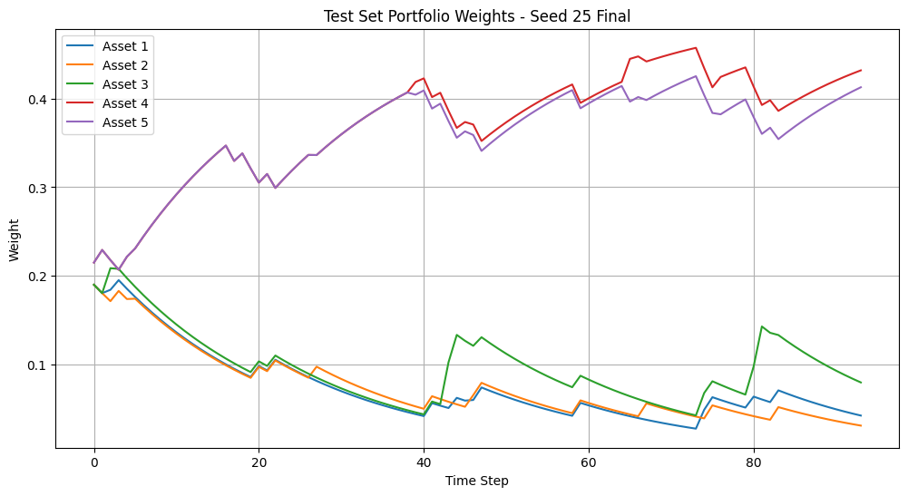
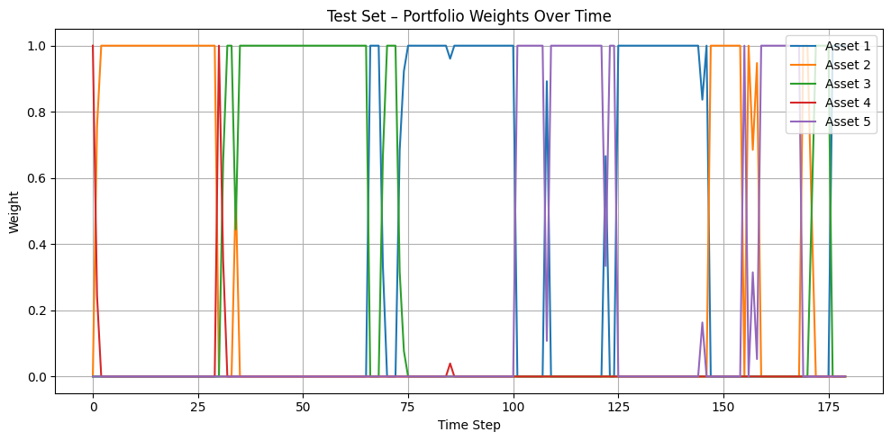

# Recurrent PPO for Portfolio Allocation

**An individual deep reinforcement learning project by Taimoor Shahzad, completed for ECE556 at the University of Victoria.**

This project explores how an LSTM-based reinforcement learning policy can adjust allocations across five stocks using recent return history. It implements Recurrent Proximal Policy Optimization (PPO) in a custom portfolio environment and compares its saved experiment results with a Markowitz mean-variance optimization (MVO) baseline.

**Python · PyTorch · Stable-Baselines3 · sb3-contrib · Gymnasium · SciPy · pandas**

## Start here

- [Main PPO/LSTM notebook](notebooks/01_recurrent_ppo_lstm.ipynb): the seed-25 experiment, including saved outputs and test plots.
- [Markowitz baseline notebook](notebooks/02_markowitz_mvo.ipynb): rolling portfolio optimization and saved evaluation results.
- [Final project report](docs/project_report.pdf) and [presentation](docs/presentation.pdf): problem formulation, method, results, and discussion.
- [Saved model checkpoint](models/ppo_best_model_seed25_round10.zip): the supplied best seed-25 model from training round 10.

You can inspect the notebooks and PDFs directly on GitHub without running training.

## Method

The asset universe is AAPL, MSFT, TSLA, AMZN, and GOOG. Daily adjusted closing prices are requested through Yahoo Finance with `yfinance`, then converted to log returns and standardized.

The main experiment uses:

| Component | Configuration |
| --- | --- |
| Observation | Flattened 25-day return window across five assets: 125 features |
| Action | Five non-negative allocations, normalized by the environment |
| Policy | `RecurrentPPO` with `MlpLstmPolicy` |
| Episode | 180 trading steps |
| Reward | Rolling Sharpe term plus return, less turnover and allocation-change penalties |
| Training data | 2015–2020 |
| Validation data | 2021–2023 |
| Reported test period | 2024; see the code/date qualifications below |
| Training | Seed 25; up to ten rounds of 50,000 requested timesteps |
| Checkpoint selection | Highest validation Sharpe, with early-stopping patience of four rounds |

## Original experiment results

These values are retained from the supplied notebook outputs and report. They were not recomputed for this repository.

| Metric | Recurrent PPO + LSTM | Markowitz MVO |
| --- | ---: | ---: |
| Saved test Sharpe ratio | **1.4228** | **0.3283** |
| Saved validation Sharpe ratio | 1.7522, best checkpoint | 2.6466, baseline episode |

The original experiment reported a higher test Sharpe for PPO. This is a historical course-project comparison with evaluation limitations, rather than evidence of reliable superiority across markets or repeated trials.

### Saved test allocation plots

Recurrent PPO:



Markowitz baseline:



The PPO plot shows the environment's smoothed weight state. [Results notes](results/README.md) explain the plot conventions and link to the saved return figures.

## Repository layout

| Path | Contents |
| --- | --- |
| `notebooks/` | Main PPO/LSTM experiment and MVO baseline |
| `notebooks/archive/` | Two earlier development notebooks, clearly labeled |
| `docs/` | Original report, presentation, experiment notes, and file inventory |
| `models/` | Supplied trained checkpoint and recorded training-system information |
| `results/` | Original metrics and six figures extracted from saved notebook outputs |
| `requirements.txt` | Dependencies for optional local notebook use |

## Optional local setup

Python 3.11 matches the supplied checkpoint's recorded training environment.

```bash
git clone https://github.com/Pyrex111/recurrent-ppo-portfolio-allocation.git
cd recurrent-ppo-portfolio-allocation
python -m venv .venv
```

Activate the environment:

```bash
# Windows PowerShell
.venv\Scripts\Activate.ps1

# macOS / Linux
source .venv/bin/activate
```

Then install dependencies and open Jupyter:

```bash
python -m pip install -r requirements.txt
python -m jupyter lab
```

Open `notebooks/01_recurrent_ppo_lstm.ipynb` to review the main experiment. Google Drive mounting is no longer required. The supplied checkpoint is under `models/`; new training outputs use the ignored `models/runs/` directory.

**The environment/function cell also contains the long training loop.** To explore the checkpoint without retraining, execute the setup and data cells, execute only the environment/function definitions from that cell, then use the test-evaluation function cells and final evaluation cell. The original notebook structure is retained. Do not use “Run All” merely to inspect saved results.

Local execution requires internet access for market data. The original market-data snapshot and fitted scaler were not supplied. Dependency installation, checkpoint inference, and notebook execution have not been tested during repository preparation.

## Experiment qualifications

The original preprocessing fits the scaler before splitting the data; the evaluation uses individual episodes; and the PPO and MVO calculations differ in costs, return conventions, and episode starts. The report describes a 2024 test period, while the PPO code also retains standardized observations into June 2025. These details affect interpretation and reproducibility.

Read [experiment notes](docs/experiment_notes.md) for the exact report/code differences and [file inventory](docs/file_inventory.md) for the seven original files and packaging edits. The original experiment logic, reported values, PDFs, and model checkpoint have been preserved.
